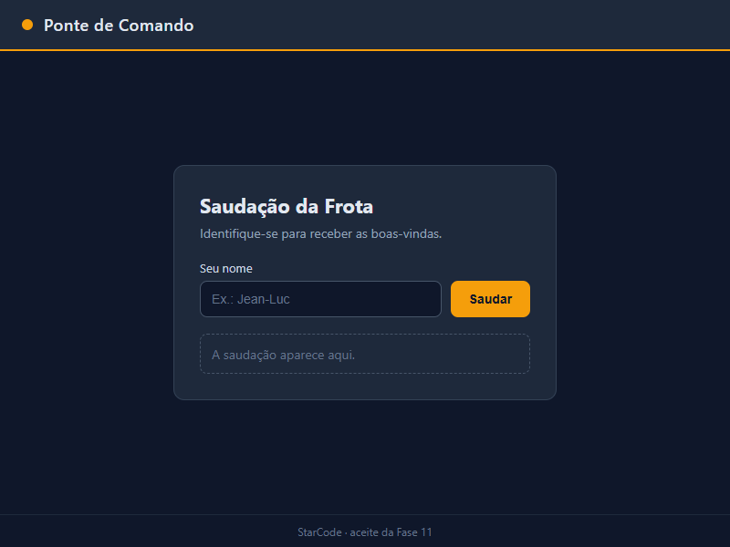

# Tela de saudação: Spec

**Approved**: 2026-11-11 - user: "sim para os dois"

**Size**: MEDIUM
**Risk triggers**: none
**May change**: index.html, src/style.css, src/main.ts, src/ui.test.ts, .specs/features/tela-saudacao/captures/saudacao.running.png

## Context
O app de aceite da Fase 11 do StarCode mostra hoje a tela padrão do template. Esta feature troca essa tela pela "Saudação da Frota" do mockup vinculante, para provar a verificação de telas: a tela rodando é capturada no tamanho do mockup (800x600) e julgada por um juiz independente.

## Scope
- A tela inicial do app segue `captures/saudacao.png`: barra superior "Ponte de Comando", cartão "Saudação da Frota", campo "Seu nome", botão "Saudar", área de mensagem e rodapé.
- O botão continua chamando o comando `greet` (Rust no app, `mockIPC` no navegador em dev).

## Non-Goals
- Mudar o comando Rust `greet` ou o `mockIPC`.
- Outras telas, temas ou responsividade fora de 800x600.

## Requirements
- **R1** - WHEN o usuário abre o app THEN the system SHALL mostrar a tela de `.specs/features/tela-saudacao/captures/saudacao.png`, com os textos "Ponte de Comando", "Saudação da Frota", "Identifique-se para receber as boas-vindas.", "Seu nome", o placeholder "Ex.: Jean-Luc", o botão "Saudar", "A saudação aparece aqui." e "StarCode · aceite da Fase 11", copiados caractere por caractere.
- **R2** - WHEN o usuário digita "Ana" e usa "Saudar" THEN the system SHALL trocar o texto da área de mensagem por "Olá, Ana!".
- **R3** - WHEN o usuário usa "Saudar" com o campo vazio THEN the system SHALL mostrar "Olá, mundo!" na área de mensagem.

## Edge Cases
- Nome com espaços nas pontas: a mensagem usa o nome sem os espaços ("  Ana " → "Olá, Ana!").

## Sources
-  - binding - tela inicial "Saudação da Frota" em 800x600.

## Differences from the Source
None - o produto segue a fonte.

## Open Questions
None.

## Checks

**Build**: `npx biome check .`; `npx tsc --noEmit`; `cd src-tauri && cargo fmt --check && cargo clippy --all-targets -- -D warnings`
**Run unit**: `npx vitest run --reporter=verbose`

**C1** - O `index.html` traz todos os textos do mockup, caractere por caractere (R1)
Proof: run unit | ✓ src/ui.test.ts > tela de saudação > traz os textos do mockup

**C2** - Com o nome "Ana", a mensagem vira "Olá, Ana!" (R2)
Proof: run unit | ✓ src/ui.test.ts > tela de saudação > mostra a saudação com o nome

**C3** - Com o campo vazio, a mensagem vira "Olá, mundo!" (R3)
Proof: run unit | ✓ src/ui.test.ts > tela de saudação > mostra a saudação ao mundo com o campo vazio

## Handoff

**Phase:** done
**Size:** MÉDIA
**Git mode:** 2
**Next:** nenhum (aceite da Fase 11 concluído)
**Linear:** PROJ-34
**Integration branch:** feature/tela-saudacao
**Last integrated:** 81b6040
**Dispatched:** Q · 9c378ae · dispatch ctx_6c5d9e1c25a3 · codex
**Settled:** none
**Attempts:** none
**Reports:** 2026-11-12: juiz de telas r1: dispatch ctx_e4de45ca439e · codex; 2026-11-12: correção pós-Q integrada 81d5329 (cf05251, 712c30c); 2026-11-12: telas r2: matches (ctx_9b77c4c26f6f)
**Breaker:** closed
